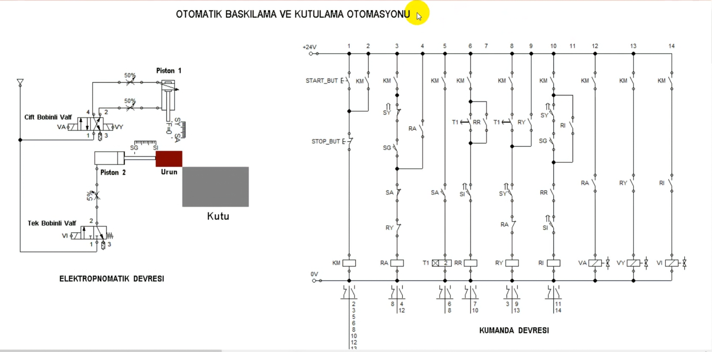
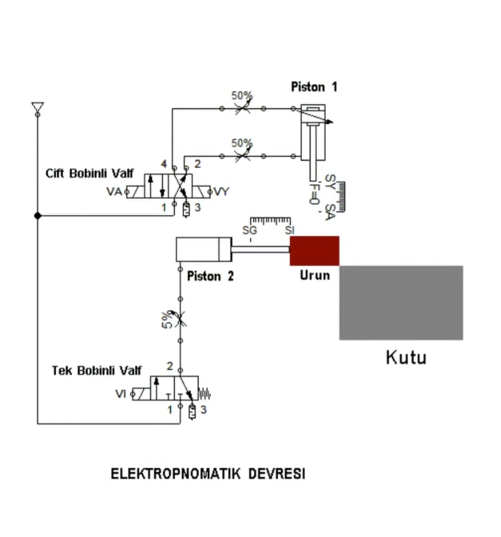
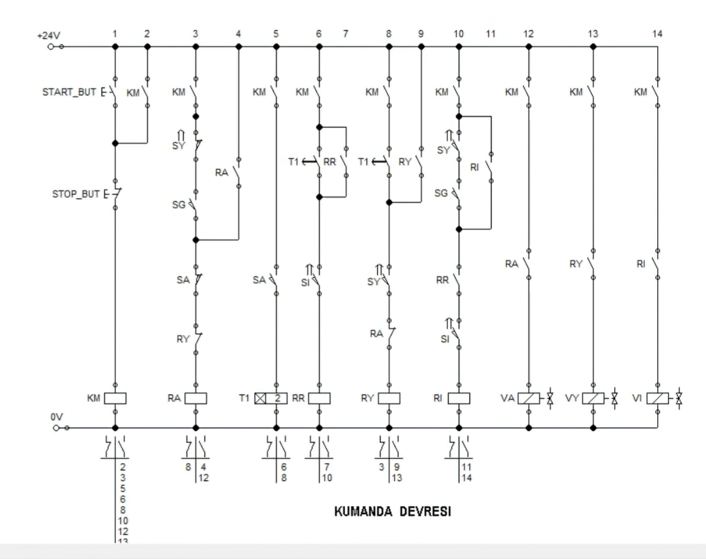
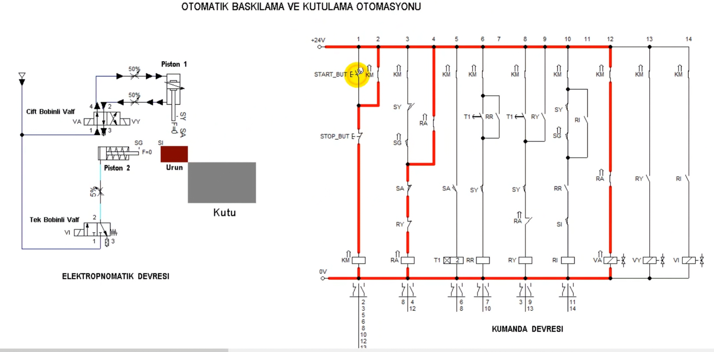
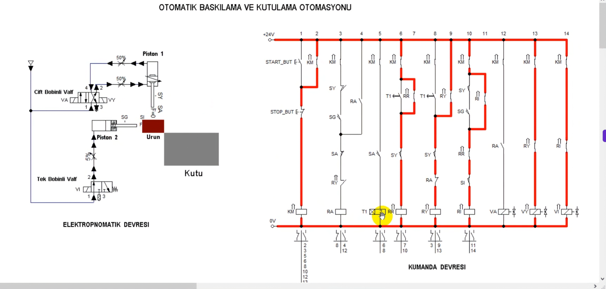
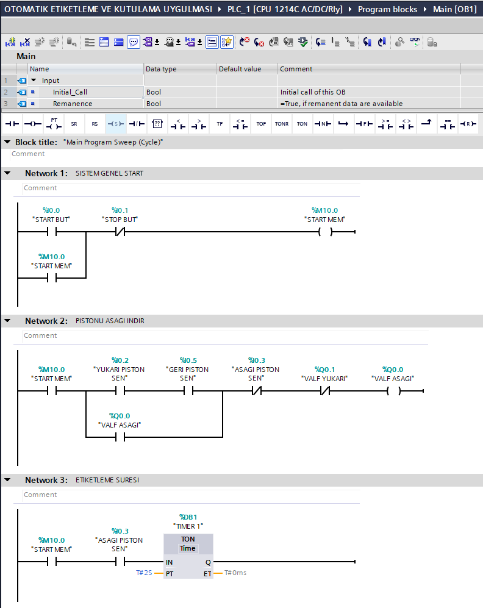
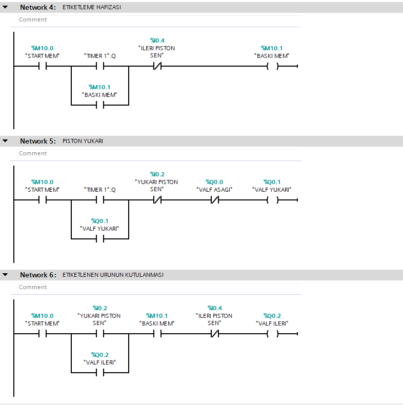
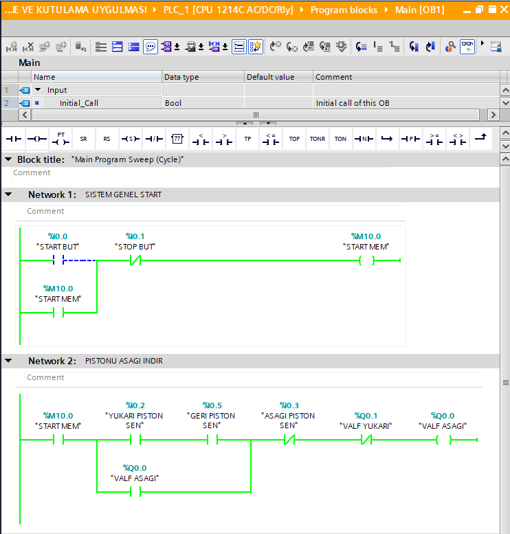
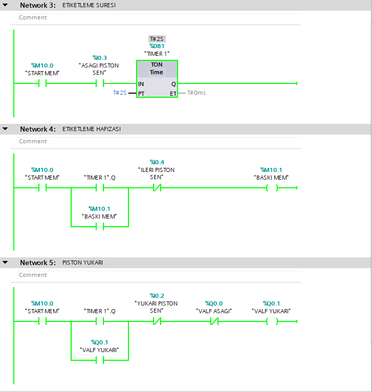
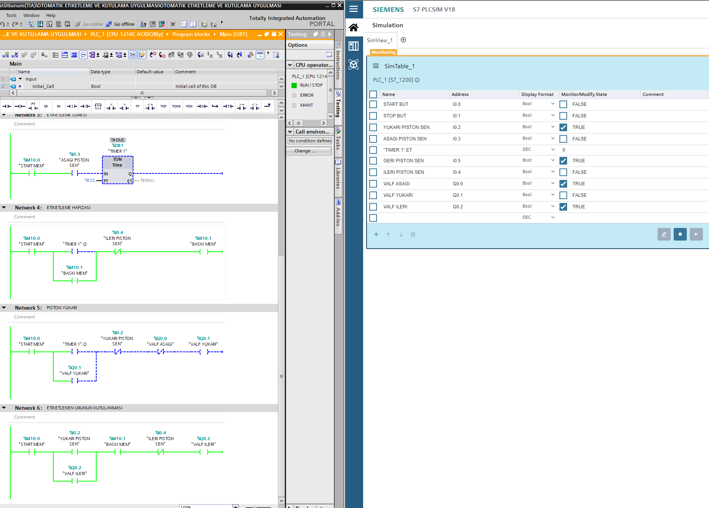

# Otomatik Baskılama ve Kutulama Otomasyonu

Bu çalışmada Siemens S7-1200 PLC (CPU 1214C AC/DC/Rly) ve TIA Portal V18 kullanılarak otomatik baskılama ve kutulama sisteminin kontrolü Ladder (LAD) programlama diliyle gerçekleştirilmiştir. Sistemde iki pnömatik piston, konum sensörleri ve solenoid valfler bulunmaktadır. PLC programında pistonların sıralı hareketleri, TON zamanlayıcı ile etiketleme/baskılama süresi ve kutulama işlemi kontrol edilmiştir. Program S7-PLCSIM V18 ortamında simüle edilerek test edilmiştir.

## Kullanılan Teknolojiler

- Siemens S7-1200 PLC (CPU 1214C AC/DC/Rly)
- TIA Portal V18
- Ladder (LAD) programlama
- S7-PLCSIM V18
- TON zamanlayıcı
- Elektropnömatik kontrol sistemleri
- Konum sensörleri ve solenoid valfler
- Start/Stop ve mühürleme devresi

## Çalışma Prensibi

1. Start butonuna basıldığında sistem mühürleme mantığıyla çalışmaya başlar.
2. Birinci piston, üst konum sensöründen ve geri konum sensöründen alınan bilgilere göre aşağı hareket eder.
3. Piston alt konuma ulaştığında TON zamanlayıcı devreye girer ve iki saniyelik etiketleme/baskılama süresi başlar.
4. Zamanlayıcı süresi tamamlandığında baskılama işlemi hafızaya alınır ve birinci piston yukarı hareket eder.
5. Birinci piston üst konuma ulaştığında ikinci piston ileri hareket ederek etiketlenen/baskılanan ürünü kutuya doğru iter.
6. İkinci piston ileri konum sensörüne ulaştığında ileri hareket tamamlanır. Tek bobinli, yay geri dönüşlü valf üzerinden pistonun geri dönüşü sağlanır.
7. Sistem bir sonraki işlem için başlangıç koşullarına döner. Stop butonuyla çalışma izni kaldırılır.

## Otomasyon Genel Devre Şeması

## Elektropnömatik Devre

## Klasik Kumanda Devresi

## Elektropnömatik Çalışma Görüntüleri

### Pistonun Aşağı Hareketi

### Baskılama ve Kutulama Hareketi

## PLC Ladder Programı

### Network 1–3: Start/Stop, Piston Kontrolü ve Zamanlama

### Network 4–6: Baskılama Hafızası, Pistonun Yukarı Hareketi ve Kutulama

## PLC Çevrimiçi İzleme Görüntüleri

### Pistonun Aşağı Hareketi

### Zamanlama ve Pistonun Yukarı Hareketi

## S7-PLCSIM Simülasyon Testi

## Proje Dosyası

TIA Portal V18 ile hazırlanmış PLC uygulamasının `.zap18` proje arşivi bu depoda bulunmaktadır.

## Uygulama Kapsamında Çalışılan Konular

- PLC dijital giriş ve çıkış adreslerinin tanımlanması
- Start/Stop ve mühürleme mantığı
- İki pnömatik pistonun sıralı kontrolü
- Konum sensörleriyle hareket kontrolü
- TON zamanlayıcı ile iki saniyelik işlem süresi oluşturulması
- PLC bellek bitleriyle işlem durumunun tutulması
- Ladder programında kilitleme ve sıralı çalışma mantığı
- Çift bobinli ve tek bobinli solenoid valf kontrolü
- S7-PLCSIM üzerinden çevrimiçi izleme ve giriş/çıkış testleri
- Elektropnömatik devre ile PLC kontrol mantığının ilişkilendirilmesi

## Çalışma Hakkında

Bu proje, endüstriyel otomasyon ve PLC programlama becerilerini geliştirmek amacıyla hazırlanmış bir eğitim uygulamasıdır. Elektropnömatik ve klasik kumanda devreleri eğitim materyallerinden referans alınmıştır. Bu devrelerin çalışma mantığı temel alınarak Siemens TIA Portal ortamında Ladder (LAD) programı oluşturulmuş ve S7-PLCSIM ile test edilmiştir.
